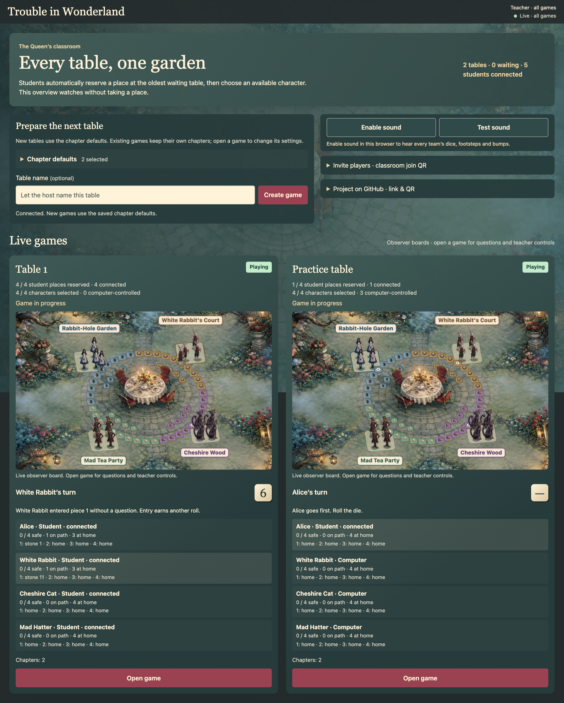
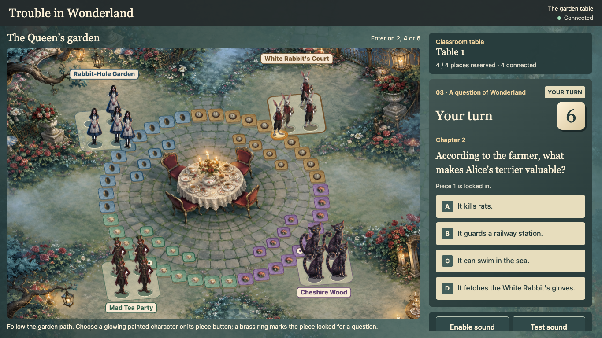
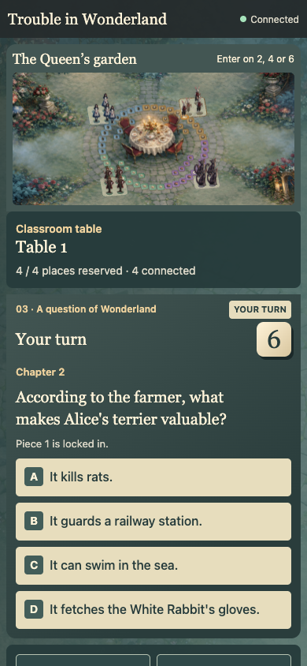

# Trouble in Wonderland

An Alice-in-Wonderland reading-comprehension board game for a classroom local network (LAN). One host runs multiple independent four-player games. Students join automatically, then choose Alice, White Rabbit, Cheshire Cat, or Mad Hatter.







## Start the server

1. Install [Bun](https://bun.sh/) on the host computer.
2. Download or clone this repository.
3. Open a terminal in the game folder.
4. Run:

   ```sh
   bun run start
   ```

5. On that computer, open `http://localhost:9276/host`.
6. Select **Chapter defaults** and save the chapters your class has read. New tables use these defaults.
7. Expand **Invite players**. Share the classroom LAN link or enlarge its QR code.
8. Keep the host computer and server running during play.

Students must use the host’s LAN address, not `localhost`. The server prints the available addresses. Allow incoming LAN connections through the firewall. Guest Wi-Fi or client isolation can prevent devices from connecting.

No cloud account, remote assets, or internet connection is needed during play. This server is for a trusted classroom LAN, not public internet hosting. To use another port, run `PORT=9277 bun run start`.

## Joining and teaching

- Each browser reserves a place at the oldest waiting table. The fifth student goes to the next table.
- Students choose an available character within their assigned table. Character choices are exclusive within that game.
- Four students who have chosen characters start immediately.
- After one minute, the server assigns any unchosen characters and fills unreserved places with bots. A connected student must be present.
- The teacher sees every table in the live grid. **Open game** shows its full board, questions, and teacher controls.
- Teacher controls can start a waiting table early, pause or resume, end a game, and reset its board. Chapter changes apply to that table.
- Close a finished table from the grid to remove it. Its returning students enter the queue again.

The host overview does not take a student place. A private server-issued browser cookie restores a student’s table and character after reconnecting. It does not use MAC addresses or show identity tokens to players. Separate tabs in one browser share that identity. Clearing browser data loses it.

## How to play

Each character has four pieces.

1. Roll **2, 4, or 6** to enter a piece on an empty protected start. Entry needs no question and earns another roll.
2. To move a piece already on the board, select it before answering its comprehension question.
3. A correct answer moves that piece forward by the roll. A successful six earns another roll.
4. A wrong answer moves it backward by the roll, stopping at its own start. A blocked backward landing leaves it in place. A wrong answer ends the turn, including on a six.
5. Landing on a rival on an ordinary stone bumps it back to its garden. Occupied protected starts block landings. Your own pieces cannot share a space.
6. Land exactly on any free one of your four final safe spots. A safe piece stays there. Do not overshoot the fourth spot.
7. The first team with all four pieces safe wins. Bots can win too.

Passing occupied spaces is allowed. If no legal action exists, continue to the next turn without a question. Numbered HTML piece buttons and the text board provide an alternative to selecting painted figures.

## Sound and display

Select **Enable sound** in each browser that should play audio. Use **Test sound** to check that device’s volume. Enabled browsers hear every team’s dice, including bot turns, a note for each movement step, and a springy capture sound. Forward and backward steps use different sounds and animations.

The painted 2D board has four Wonderland regions and quick per-space hops. Phone layouts keep questions and answer buttons readable. Reduced-motion settings remove movement and tumbling. Both teacher and player pages include expandable classroom and GitHub links with QR codes.

## Questions and progress

`questions.json` contains **500 questions across all 12 chapters** of Lewis Carroll’s original *Alice’s Adventures in Wonderland*. Chapters 1–8 have 42 questions each. Chapters 9–12 have 41 each.

Each question has a chapter, prompt, four options, a zero-based answer index, explanation, and supporting source quotation. The server selects only configured chapters, shuffles answer options, and exhausts the eligible question pool before repeating. It does not send the answer key or source quotation before an answer.

Source: [Project Gutenberg, ebook 11](https://www.gutenberg.org/ebooks/11). Check applicable text rights in your jurisdiction. The artwork is original generated painting, not extracted commercial game art.

All tables, reservations, and progress live in server memory. A server restart clears them. Restart the server after changing the question bank. Reconnecting to a running server preserves the current game.

## Developer check

```sh
bun test
```

Tests cover movement, safe spots, captures, entry bonuses, chapter selection, grouping, reconnects, identity boundaries, and game isolation. Browser checks exercise the live grid, student controls, mobile layout, sound, and QR codes.
